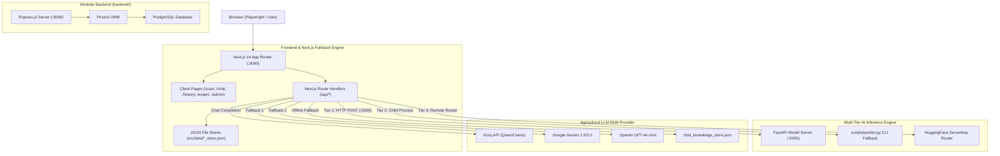

# KrishiDrishti — Comprehensive Technical Audit & Playwright Automation Readiness Assessment

**Document Version:** 1.0.0  
**Audit Date:** 2026-10-29  
**Auditor:** Senior Software Architect, QA Automation Architect & Playwright Testing Specialist  
**Target Repository:** `krishi-drishti` (`d:\KnowledgeVault\Project\krishi-drishti`)  
**Status:** Baseline Specification for Playwright Automation Planning (Read-Only Analysis)

---

## 1. Executive Summary

This technical audit provides an exhaustive architectural, functional, and automated testing inspection of the **KrishiDrishti** codebase. KrishiDrishti is an AI-powered agricultural pathology screening platform and bilingual (Bangla/English) agronomic advisory assistant. 

The application is architected primarily as a **hybrid fullstack Next.js 14 (App Router) monolith** supported by:
1. An integrated Next.js API layer with file-backed JSON transactional persistence (`src/data/*_store.json`), allowing complete, standalone zero-database local execution.
2. A high-performance Python FastAPI neural inference server (`scripts/model_server.py`) serving a 50-class fine-tuned ConvNeXt-Tiny model (`ripro805/krishidrishti-plant-disease`) on port 5005.
3. An optional modular Node.js/Express + Prisma ORM + PostgreSQL service located in `backend/` for enterprise PostgreSQL persistence.

### Key Audit Findings
- **Zero Existing Playwright Setup:** No `playwright.config.*` or `@playwright/test` test runners currently exist in the repository. Existing tests consist of standalone Node.js API scripts in `scripts/` (e.g., `test_auth_suite.mjs`, `test_chatbot_suite.mjs`).
- **High Automation Feasibility:** The frontend utilizes clean semantic HTML forms, standard input IDs (e.g., `id="email"`, `id="password"`, `id="calcCrop"`, `id="fieldSize"`), and deterministic state machines, making it primed for resilient Playwright browser testing.
- **Built-in Deterministic Test Accounts:** The authentication system natively seeds three standard test credentials with 1-click UI bypasses (`farmer@krishidrishti.gov.bd`, `expert@krishidrishti.gov.bd`, `admin@krishidrishti.gov.bd`), greatly simplifying end-to-end authentication setup.
- **Mocking & Fixture Requirements:** Real neural inference and external LLM APIs (Groq, Gemini, OpenAI) can be selectively mocked at the network route level (`page.route('/api/detect', ...)` and `page.route('/api/chat', ...)`) to ensure fast, zero-flakiness, offline-capable CI test execution.

---

## 2. Verified Technology Stack

| Layer | Technology | Verified Version | Configuration File / Reference |
|---|---|---|---|
| **Frontend Framework** | Next.js (App Router) | `14.2.15` | [package.json](file:///d:/KnowledgeVault/Project/krishi-drishti/package.json#L31) |
| **UI Library** | React | `18.3.1` | [package.json](file:///d:/KnowledgeVault/Project/krishi-drishti/package.json#L32) |
| **Language (Frontend/Next)** | TypeScript | `5.6.3` | [tsconfig.json](file:///d:/KnowledgeVault/Project/krishi-drishti/tsconfig.json) |
| **Styling & Design System** | TailwindCSS + PostCSS | `3.4.14` / `8.5.30` | [tailwind.config.ts](file:///d:/KnowledgeVault/Project/krishi-drishti/tailwind.config.ts) |
| **Icons** | Lucide React | `1.59.0` | [package.json](file:///d:/KnowledgeVault/Project/krishi-drishti/package.json#L30) |
| **Client Auth / Crypto** | `jsonwebtoken` & `bcryptjs` | `9.0.3` / `3.0.3` | [package.json](file:///d:/KnowledgeVault/Project/krishi-drishti/package.json#L26-L29) |
| **Visual Effects** | `canvas-confetti` | `1.9.4` | [package.json](file:///d:/KnowledgeVault/Project/krishi-drishti/package.json#L27) |
| **Backend (Optional Modular)** | Express.js | `4.21.1` | [backend/package.json](file:///d:/KnowledgeVault/Project/krishi-drishti/backend/package.json#L33) |
| **ORM & Database** | Prisma ORM / PostgreSQL | `5.21.1` | [backend/prisma/schema.prisma](file:///d:/KnowledgeVault/Project/krishi-drishti/backend/prisma/schema.prisma) |
| **AI Inference Microservice** | FastAPI / Uvicorn | `2.0.0` (FastAPI) | [scripts/model_server.py](file:///d:/KnowledgeVault/Project/krishi-drishti/scripts/model_server.py#L9) |
| **Deep Learning Framework** | PyTorch & HuggingFace Transformers | Python 3.x / Torch | [scripts/model_server.py](file:///d:/KnowledgeVault/Project/krishi-drishti/scripts/model_server.py#L13-L14) |
| **Computer Vision Model** | ConvNeXt-Tiny (50 classes) | `ripro805/krishidrishti-plant-disease` | [scripts/crop_registry.py](file:///d:/KnowledgeVault/Project/krishi-drishti/scripts/crop_registry.py) |
| **Package Manager** | `npm` (Lockfile v3) | `package-lock.json` present | [package-lock.json](file:///d:/KnowledgeVault/Project/krishi-drishti/package-lock.json) |

---

## 3. Project Architecture

KrishiDrishti is organized into three interconnected tiers:



### Architectural Classification
- **Application Type:** Hybrid Fullstack Monolith. The Next.js 14 application is completely autonomous: it provides all UI screens, server-rendered views, API endpoints, file uploads, and authentication.
- **Decoupled Services:** 
  - `scripts/model_server.py`: Dedicated lightweight Python daemon for low-latency neural model evaluation.
  - `backend/`: Supplementary Express microservice designed for enterprise PostgreSQL deployments. The Next.js frontend defaults to `/api` when `NEXT_PUBLIC_API_URL` is omitted, making the Next.js app 100% self-sufficient for testing.

---

## 4. Relevant Directory Structure

```text
d:\KnowledgeVault\Project\krishi-drishti\
├── backend/                             # Optional Express + Prisma backend
│   ├── prisma/schema.prisma             # PostgreSQL schema definition
│   ├── src/                             # Express server source code
│   └── package.json                     # Express dependencies
├── public/                              # Static public assets
│   ├── uploads/scans/                   # Local image storage destination
│   └── ...                              # SVG icons and sample graphics
├── reports/                             # Model evaluation and audit reports
├── scripts/                             # Verification, model server & CLI tools
│   ├── crop_registry.py                 # Authoritative 50-class crop definitions
│   ├── crop_taxonomy.py                 # Botanical validation & hierarchical guard
│   ├── model_server.py                  # FastAPI persistent inference server (:5005)
│   ├── predict.py                       # CLI fallback inference script
│   └── test_*_suite.mjs                 # Existing Node.js API integration tests
├── src/                                 # Next.js Application Source
│   ├── app/                             # Next.js 14 App Router
│   │   ├── admin/                       # Admin CMS & Monitoring pages
│   │   │   ├── content/page.tsx         # Content management
│   │   │   ├── diseases/page.tsx        # Disease database management
│   │   │   ├── feedback/page.tsx        # Farmer feedback moderation
│   │   │   ├── predictions/page.tsx     # Scan prediction monitoring
│   │   │   ├── users/page.tsx           # User administration
│   │   │   └── page.tsx                 # Main Admin KPI Dashboard
│   │   ├── api/                         # Next.js Serverless Route Handlers
│   │   │   ├── admin/stats/route.ts     # Admin aggregated analytics API
│   │   │   ├── auth/                    # login, register, me, logout APIs
│   │   │   ├── chat/route.ts            # LLM chatbot & knowledge base API
│   │   │   ├── detect/route.ts          # 3-tier foliar disease detector API
│   │   │   ├── diseases/route.ts        # Disease encyclopedia REST API
│   │   │   ├── feedback/route.ts        # Model feedback REST API
│   │   │   ├── scans/route.ts           # Scan history CRUD REST API
│   │   │   ├── tts/route.ts             # Bangla voice synthesis audio API
│   │   │   └── upload/route.ts          # Local/Cloud leaf image upload API
│   │   ├── calculator/page.tsx          # Precision N-P-K dosage calculator
│   │   ├── chat/page.tsx                # Bangla AI Agricultural Assistant
│   │   ├── crop-doctor/page.tsx         # Direct agronomic advisor interface
│   │   ├── expert/page.tsx              # Expert consultation & review portal
│   │   ├── features/page.tsx            # Product feature marketing showcase
│   │   ├── history/page.tsx             # Farmer scan history tracking page
│   │   ├── library/page.tsx             # Plant pathology encyclopedia
│   │   ├── login/page.tsx               # Login with 1-click demo accounts
│   │   ├── pricing/page.tsx             # Pricing tiers showcase
│   │   ├── register/page.tsx            # Farmer registration page
│   │   ├── scan/page.tsx                # AI Leaf Disease Scanner Studio
│   │   ├── supported-crops/page.tsx     # 16 supported crops directory
│   │   ├── layout.tsx                   # Root HTML shell & global providers
│   │   └── page.tsx                     # Landing page with hero & live demo
│   ├── components/                      # Reusable React components
│   │   ├── admin/AdminLayout.tsx        # Admin control panel layout wrapper
│   │   ├── chat/AgriChatbotConsole.tsx  # Chat conversation UI & message list
│   │   ├── common/                      # Button, Badge, Card, Modal, Navbar, Footer
│   │   ├── home/                        # Landing page sectional components
│   │   └── scanner/                     # Scanner components (Dropzone, Camera, Result)
│   ├── context/                         # Client Context Providers
│   │   ├── AuthContext.tsx              # Auth state, session cache & demo login
│   │   └── LanguageContext.tsx          # Bilingual toggle (Bangla / English)
│   ├── data/                            # Static databases and JSON stores
│   │   ├── diseasesDatabase.ts          # 200+ detailed disease monographs
│   │   ├── sampleLeaves.ts              # Preset test images with base64 data
│   │   └── *_store.json                 # JSON transactional persistence files
│   ├── hooks/                           # Custom React Hooks
│   │   ├── useFertilizerCalc.ts         # Dosage calculation logic hook
│   │   ├── useScanHistory.ts            # Scan history fetch/filter/delete hook
│   │   └── useScanner.ts                # Scan upload, inference & state hook
│   ├── lib/                             # Utility & Service Libraries
│   │   ├── apiClient.ts                 # Unified typed API client
│   │   ├── cropRegistry.ts              # TypeScript crop & threshold definitions
│   │   └── diseaseDetector.ts           # Client diagnosis resolver & formatters
│   └── types/                           # TypeScript interfaces & domain types
├── package.json                         # Project metadata and dependencies
└── tsconfig.json                        # TypeScript configuration
```

---

## 5. Application Features Inventory

| # | Feature Name | Primary Route | Permitted Roles | Description & Core User Actions | Status |
|---|---|---|---|---|---|
| **1** | **AI Leaf Disease Scanner** | `/scan` | Public / All | Upload foliar image, select crop hint, run neural screening, view pathology result, leaf metrics, and treatment tabs. | Fully Implemented |
| **2** | **Sample Leaf Preset Testing** | `/scan` | Public / All | Select preset high-resolution leaves (Tomato, Potato, Rice, Corn) without requiring local files. | Fully Implemented |
| **3** | **Live Camera Capture** | `/scan` | Public / All | Open webcam modal, capture leaf photo via `CameraModal.tsx`, and run diagnostic inference. | Fully Implemented |
| **4** | **Crop Mismatch & OOD Guard** | `/scan`, `/api/detect` | Public / All | Rejects cross-crop confusion (e.g. Rice blights on Corn) and out-of-distribution non-foliar uploads. | Fully Implemented |
| **5** | **Bangla Voice Assistant (TTS)** | `/scan` | Public / All | Synthesizes Bangla voice advisory for illiterate/rural farmers via server-side `/api/tts`. | Fully Implemented |
| **6** | **PDF Pathology Dossier** | `/scan` | Public / All | Generates printable clinical PDF diagnosis with treatment schedule and severity metrics. | Fully Implemented |
| **7** | **Prediction Feedback** | `/scan`, `/history` | Public / All | Farmers submit validation rating (`accurate`, `inaccurate`, `unsure`) with optional notes. | Fully Implemented |
| **8** | **AI Agriculture Chatbot** | `/chat`, `/crop-doctor` | Public / All | Multilingual LLM chat with quick prompt chips, markdown rendering, and local fallback knowledge. | Fully Implemented |
| **9** | **Scan History & Health Tracking**| `/history` | Public / Farmer | View previous field scans, filter by crop or status (`Active`, `Treated`, `Monitoring`), delete logs. | Fully Implemented |
| **10** | **Disease Encyclopedia** | `/library` | Public / All | Searchable plant pathology archive of 200+ diseases with pathogen filters (`Fungal`, `Bacterial`, `Viral`). | Fully Implemented |
| **11** | **N-P-K Fertilizer Calculator** | `/calculator` | Public / All | Calculate exact Urea, DAP, MOP, Gypsum, Zinc dosages based on field area, unit, and soil N-P-K levels. | Fully Implemented |
| **12** | **Authentication & Roles** | `/login`, `/register` | Public / All | Register farmer accounts, login with password, or opt-in with 1-click Demo credentials. | Fully Implemented |
| **13** | **Bilingual Language Switcher** | Global Navbar | Public / All | 1-click toggle between Bengali (বাংলা) and English across all UI labels and clinical advice. | Fully Implemented |
| **14** | **Supported Crops Directory** | `/supported-crops` | Public / All | Detailed agronomic guide for 16 supported crops with disease listings and cultivation seasons. | Fully Implemented |
| **15** | **Agronomist Expert Portal** | `/expert` | `expert`, `admin` | Review escalated/low-confidence scans, prescribe chemical/organic treatments, moderate feedback queue. | Fully Implemented |
| **16** | **Admin Control Panel** | `/admin/*` | `admin` | KPI dashboard, user list, disease CRUD, prediction activity logs, feedback moderation, notices CMS. | Fully Implemented |
| **17** | **Pricing & Marketing** | `/pricing`, `/features` | Public / All | Static showcase of platform capabilities and tier descriptions. | Presentation Only |

---

## 6. Routes and User Roles

### User Roles
- `farmer`: Default role for registered users; can scan, save history, submit feedback, use chatbot.
- `expert`: Agronomist role; permitted to access `/expert` portal, review escalated scans, write prescriptions.
- `admin`: System administrator; permitted to access `/admin` and `/expert`, manage users, diseases, and stats.

### Route Access Matrix

| Route Path | Access Level | Permitted Roles | Behavior on Unauthorized Access |
|---|---|---|---|
| `/` | Public | Unauthenticated / All | Public landing page with live interactive demo. |
| `/scan` | Public | Unauthenticated / All | Public scanner. Results can be saved to local storage or user account. |
| `/chat` | Public | Unauthenticated / All | Public LLM agricultural assistant. |
| `/crop-doctor` | Public | Unauthenticated / All | Alternate public interface to the AI assistant. |
| `/library` | Public | Unauthenticated / All | Public encyclopedia. |
| `/calculator` | Public | Unauthenticated / All | Public agronomic calculator. |
| `/history` | Public / User | All (Persists locally or by User) | Displays saved scans. Unauthenticated users see browser-cached scans. |
| `/supported-crops` | Public | Unauthenticated / All | Informational directory. |
| `/pricing` | Public | Unauthenticated / All | Marketing tier descriptions. |
| `/features` | Public | Unauthenticated / All | Product feature showcase. |
| `/login` | Public (Guest) | Unauthenticated | Redirects to `/scan` upon successful login. |
| `/register` | Public (Guest) | Unauthenticated | Redirects to `/scan` upon successful registration. |
| `/expert` | **Protected** | `expert`, `admin` | Shows inline "Switch to Expert" demo button or warning banner if unauthenticated. |
| `/admin` | **Protected** | `admin` | Shows inline "Switch to Admin" demo button or access warning banner if non-admin. |
| `/admin/users` | **Protected** | `admin` | Sub-page of AdminLayout. |
| `/admin/diseases` | **Protected** | `admin` | Sub-page of AdminLayout. |
| `/admin/predictions`| **Protected** | `admin` | Sub-page of AdminLayout. |
| `/admin/feedback` | **Protected** | `admin` | Sub-page of AdminLayout. |
| `/admin/content` | **Protected** | `admin` | Sub-page of AdminLayout. |

---

## 7. Major User Journeys

### Journey 1: Foliar Scan via Sample Leaf (Positive Path)
1. User lands on `/scan`.
2. User selects crop hint button (e.g. `Tomato` or `Auto-Detect`).
3. User scrolls to "Sample Leaf Selector" and clicks a preset (e.g. `Tomato Early Blight`).
4. Selected image preview appears in `Dropzone`.
5. Trigger bar displays: *"Specimen Ready for Neural Processing"*.
6. User clicks `Run AI Disease Analysis` button.
7. `ScanningAnimation` activates (progress stages: Optical Normalization, Neural Inference, Safety Check).
8. `DiagnosticResultCard` appears with:
   - Disease Name, Confidence percentage, Etiology badge, Severity level.
   - `TreatmentPlanTabs` (Immediate, Organic, Chemical, Preventive).
   - `PredictionFeedbackCard` allowing farmer rating.
9. User clicks `Save Scan` (`হিস্ট্রিতে সংরক্ষিত হয়েছে`).

### Journey 2: Out-of-Distribution or Ambiguous Image (Negative / Guard Path)
1. User uploads a non-leaf image or an ambiguous cereal leaf without selecting a crop.
2. User triggers analysis.
3. System responds with `status: "unknown_crop"`.
4. `DiagnosticResultCard` renders amber warning: *"অনির্ণীত ফলাফল / Unable to Determine Diagnosis Reliably"*.
5. Treatment tabs and chemical recommendations are strictly suppressed to prevent crop damage.

### Journey 3: Authentication & 1-Click Role Switch
1. User navigates to `/login`.
2. Under "Fast 1-Click Demo Accounts", user clicks `কৃষিবিদ (Expert)`.
3. System calls `demoLogin('expert')`, sets JWT cookie and `localStorage` session.
4. User is redirected to `/scan`.
5. User opens Navbar dropdown menu; `বিশেষজ্ঞ পোর্টাল (Expert Portal)` is now visible.
6. User clicks link to enter `/expert`.

### Journey 4: Agronomist Escalation & Prescription Workflow
1. Expert user navigates to `/expert`.
2. Under `Escalated Scans` tab, clicks `রিভিউ করুন (Review)` on a pending scan.
3. Modal opens showing leaf image, detected disease, and confidence.
4. Expert types advisory note and prescription in textarea fields.
5. Expert changes status to `Treated` and clicks `পরামর্শ জমা দিন (Submit Consultation)`.
6. Scan record updates; success banner displays.

### Journey 5: N-P-K Fertilizer Calculation
1. User navigates to `/calculator`.
2. Selects Target Crop (e.g. `Rice (Paddy)`).
3. Inputs Field Area: `2.5`, Unit: `Acre`.
4. Selects Soil Nitrogen: `Low`, Phosphorus: `Medium`, Potassium: `High`.
5. Results auto-calculate in real time:
   - Urea requirement in kg.
   - DAP and MOP requirements in kg.
   - Split-application schedule (Basal dressing, Tillering stage, Panicle initiation).

---

## 8. UI Components and Locator Inventory

### Key Page Elements and Locators

| Page / Component | Element Name | Tag / Type | Verified Accessible Label / Role / ID | Recommended Playwright Locator |
|---|---|---|---|---|
| **Global Navbar** | Brand Logo Link | `<a>` | `"KrishiDrishti"`, `"কৃষি দৃষ্টি"` | `page.locator('header a[href="/"]')` |
| **Global Navbar** | Language Switcher | `<button>` | `"English"`, `"বাংলা"` | `page.getByTitle(/language/i).or(page.locator('header button:has-text("English"), header button:has-text("বাংলা")'))` |
| **Global Navbar** | Navigation Links | `<a>` | `"Disease Scanner"`, `"AI Agri Assistant"`, etc. | `page.getByRole('link', { name: /scanner\|স্ক্যানার/i })` |
| **Global Navbar** | User Profile Dropdown| `<button>` | Displays user first name | `page.locator('header button img[alt]').locator('..')` |
| **Global Navbar** | Logout Button | `<button>` | `"লগআউট"`, `"Sign Out"` | `page.getByRole('button', { name: /sign out\|লগআউট/i })` |
| **Scanner Page** | Target Crop Button | `<button>` | `"Tomato"`, `"ধান"`, `"Auto-Detect"` | `page.getByRole('button', { name: /tomato\|টমেটো/i })` |
| **Scanner Page** | File Input | `<input type="file">` | Hidden dropzone input | `page.locator('input[type="file"]')` |
| **Scanner Page** | Camera Modal Open | `<button>` | `"Camera"`, `"ক্যামেরা"` | `page.getByRole('button', { name: /camera\|ক্যামেরা/i })` |
| **Scanner Page** | Trigger Scan Button | `<button>` | `"Run AI Disease Analysis"`, `"এআই দিয়ে রোগ নির্ণয় করুন"` | `page.getByRole('button', { name: /run ai disease analysis\|এআই দিয়ে রোগ নির্ণয়/i })` |
| **Scanner Page** | Clear Image Button | `<button>` | `"Clear"`, `"বাতিল"` | `page.getByRole('button', { name: /clear\|বাতিল/i })` |
| **Scanner Page** | Preset Leaf Sample | `<button>` | Image card inside `SampleLeafSelector` | `page.locator('button:has-text("Tomato"), button:has-text("Potato")').first()` |
| **Scanner Result** | Save Scan Button | `<button>` | `"Save Scan"`, `"ফলাফল সংরক্ষণ করুন"` | `page.getByRole('button', { name: /save scan\|সংরক্ষণ/i })` |
| **Scanner Result** | PDF Report Button | `<button>` | `"Generate PDF Pathology Dossier"` | `page.getByRole('button', { name: /pdf/i })` |
| **Scanner Result** | Treatment Plan Tab | `<button>` | `"Immediate"`, `"Organic"`, `"Chemical"` | `page.getByRole('tab', { name: /organic\|জৈব/i })` |
| **Scanner Result** | Feedback Thumbs Up | `<button>` | Accurate rating button | `page.locator('button:has-text("সঠিক"), button:has-text("Accurate")')` |
| **Chatbot Page** | Message Input | `<input>` / `<textarea>` | `"আপনার প্রশ্ন লিখুন..."` | `page.getByPlaceholder(/প্রশ্ন লিখুন\|ask/i)` |
| **Chatbot Page** | Send Message Button| `<button>` | Send icon button | `page.locator('form button[type="submit"]')` |
| **Calculator Page** | Crop Select | `<select>` | `id="calcCrop"` | `page.locator('#calcCrop')` |
| **Calculator Page** | Field Area Input | `<input>` | `id="fieldSize"` | `page.locator('#fieldSize')` |
| **Calculator Page** | Area Unit Select | `<select>` | `id="fieldUnit"` | `page.locator('#fieldUnit')` |
| **Login Page** | Email Input | `<input>` | `id="email"`, type `"email"` | `page.locator('#email')` |
| **Login Page** | Password Input | `<input>` | `id="password"`, type `"password"` | `page.locator('#password')` |
| **Login Page** | Submit Button | `<button>` | `"প্রবেশ করুন"`, `"Sign In"` | `page.getByRole('button', { name: /sign in\|প্রবেশ করুন/i })` |
| **Login Page** | 1-Click Demo Farmer| `<button>` | `"কৃষক"`, `"Farmer"` | `page.getByRole('button', { name: /farmer\|কৃষক/i })` |
| **Login Page** | 1-Click Demo Expert| `<button>` | `"কৃষিবিদ"`, `"Officer"` | `page.getByRole('button', { name: /expert\|কৃষিবিদ/i })` |
| **Login Page** | 1-Click Demo Admin | `<button>` | `"অ্যাডমিন"`, `"Admin"` | `page.getByRole('button', { name: /admin\|অ্যাডমিন/i })` |
| **History Page** | Delete Scan Item | `<button>` | Trash icon button on scan card | `page.locator('button:has-text("মুছুন"), button:has-text("Delete")')` |
| **History Page** | Clear All Logs | `<button>` | `"Clear Log"`, `"ইতিহাস মুছুন"` | `page.getByRole('button', { name: /clear log\|ইতিহাস মুছুন/i })` |

---

## 9. API Inventory

All API endpoints are hosted under Next.js 14 App Router route handlers.

### 1. Authentication (`/api/auth`)
- `POST /api/auth/login`: Accepts `{ email, password }`. Returns `{ success: true, user, token }` and sets HTTP-only cookie `krishi_auth_token`.
- `POST /api/auth/register`: Accepts `{ name, email, password, phone?, role?, district?, upazila? }`. Returns 200 with JWT or 409 if email exists.
- `GET /api/auth/me`: Reads Bearer token or HTTP-only cookie. Returns `{ user }` or 401.
- `POST /api/auth/logout`: Clears `krishi_auth_token` cookie. Returns `{ success: true }`.

### 2. Foliar Pathology Detection (`/api/detect`)
- `POST /api/detect`:
  - **Payload:** `{ imageData: string (base64/dataURL), cropHint?: string }`
  - **Processing:** Multi-tier execution (Tier 1: FastAPI `:5005` -> Tier 2: `scripts/predict.py` -> Tier 3: HF Inference Router).
  - **Validation:** Pre-inference image variance & blur check (`validate_image_quality`), cross-crop ambiguity guard.
  - **Response:**
    ```json
    {
      "status": "success | crop_mismatch | unknown_crop | low_confidence | invalid_image",
      "can_provide_treatment": true,
      "detected_crop": "Tomato",
      "bangla_detected_crop": "টমেটো",
      "confidence": 99.25,
      "prediction": { "label": "Tomato_Early_blight", "score": 0.9925, "isHealthy": false },
      "predictions": [{ "label": "...", "score": 0.9925, "raw_score": 0.4834 }]
    }
    ```

### 3. Scan History (`/api/scans`)
- `GET /api/scans`: Query params: `?crop=...&status=...&page=...&limit=...&escalated=true`. Returns list of saved scans.
- `POST /api/scans`: Saves completed scan record.
- `GET /api/scans/[id]`: Retrieves scan detail by ID.
- `PATCH /api/scans/[id]`: Updates scan status or attaches agronomist consultation notes.
- `DELETE /api/scans/[id]`: Deletes scan record.

### 4. Prediction Feedback (`/api/feedback`)
- `GET /api/feedback`: Query params: `?status=...&rating=...`. Returns feedback items and aggregated statistics.
- `POST /api/feedback`: Accepts `{ scanId, crop, disease, confidence, rating, comment? }`.
- `PATCH /api/feedback/[id]`: Moderates feedback (`status: 'new' | 'reviewed' | 'flagged'`).

### 5. AI Chatbot & Knowledge Base (`/api/chat`)
- `POST /api/chat`: Accepts `{ message, history?, diseaseContext?, languagePreference? }`.
- **Rate Limiting:** Enforces 30 requests/minute per client IP (returns 429 `RATE_LIMIT_EXCEEDED`).
- **Response:** `{ success: true, answer: string, provider: string, cached: boolean }`.

### 6. Bangla Voice Synthesis (`/api/tts`)
- `GET /api/tts?text=...` / `POST /api/tts { text: "..." }`:
- Returns `audio/mpeg` binary stream with server-side caching (max 100 entries).

### 7. Image Upload (`/api/upload`)
- `POST /api/upload`: Accepts `multipart/form-data` or JSON base64. Limits file size to 15MB.
- Stores file in `public/uploads/scans/` (or Cloudinary / S3 if keys are supplied).

### 8. Admin Statistics (`/api/admin/stats`)
- `GET /api/admin/stats`: Returns KPI metrics `{ usersCount, scansCount, lowConfidenceCount, feedbackStats, diseasesCount, recentScans }`.

---

## 10. Database and Data Model Overview

### 1. Active Next.js File-Based Persistence
In standard development and standalone mode, Next.js persists transactional data to local JSON stores in `src/data/`:
- `users_store.json`: User accounts, hashed passwords, roles, contact details.
- `scans_store.json`: Scan logs, detected pathologies, confidence, severity, expert consultations.
- `feedback_store.json`: Farmer feedback ratings and moderation statuses.
- `diseases_store.json`: Custom or updated disease entries.
- `chat_knowledge_store.json`: Offline FAQ query-answer pairs.

### 2. Optional Enterprise PostgreSQL Schema (`backend/prisma/schema.prisma`)
The modular backend defines equivalent PostgreSQL relational models:
- **`User`**: `id`, `name`, `email`, `passwordHash`, `phone`, `role` (`FARMER`, `EXPERT`, `ADMIN`), `district`, `upazila`.
- **`Disease`**: `id`, `crop`, `commonName`, `banglaName`, `scientificName`, `severity`, `treatmentPlan` (JSON).
- **`Scan`**: `id`, `scanCode`, `cropDetected`, `confidence`, `severity`, `imageUrl`, `status`, `userId`.
- **`Feedback`**: `id`, `scanId`, `rating`, `comment`, `status`.
- **`Notice`**: `id`, `title`, `content`, `category`, `active`.
- **`FertilizerCalculation`**: Field dimensions, soil test levels, resulting nutrient dosages.

---

## 11. Authentication and Authorization

### Mechanism
- **Tokens:** JSON Web Tokens (JWT) signed with `JWT_SECRET` (default fallback key configured in source: `krishi-drishti-jwt-secret-key-2026-production`).
- **Expiration:** 7 days (`7d`).
- **Storage:**
  - Client storage: `localStorage.getItem("KRISHI_DRISHTI_AUTH_TOKEN")`.
  - HTTP Cookie: `krishi_auth_token` (`httpOnly: true`, `sameSite: "lax"`, `path: "/"`).
- **Password Security:** Hashed with `bcryptjs` (salt rounds: 10).

### Role Hierarchy & Permissions
1. **Farmer (`farmer`):**
   - Permitted: Scan foliar leaves, access chat assistant, view personal history, save scans, submit feedback, calculate fertilizers.
   - Denied: Cannot access `/expert` or `/admin`.
2. **Expert (`expert`):**
   - Permitted: Everything a farmer can do, plus access to `/expert` to review low-confidence scans and write agronomist prescriptions.
   - Denied: Cannot access `/admin`.
3. **Admin (`admin`):**
   - Permitted: Unrestricted access across all public routes, `/expert`, and `/admin/*`.

---

## 12. External Integrations

| Service / Provider | Purpose | Default Mode / Fallback | Safety / Testing Consideration |
|---|---|---|---|
| **FastAPI Model Server** | Local 50-class neural pathology inference | Runs on port 5005 via `python scripts/model_server.py`. Falls back to CLI `scripts/predict.py`. | Mockable via `page.route('**/api/detect', ...)` in Playwright for instant, GPU-free test runs. |
| **Hugging Face Hub** | Remote inference / Model hosting | `ripro805/krishidrishti-plant-disease` | Remote fallback only. Tests do not require live HF API calls. |
| **Groq API** | Ultra-fast LLM chatbot responses | `GROQ_API_KEY` | If key is missing or exhausted, falls back to Gemini, OpenAI, or local `chat_knowledge_store.json`. |
| **Google Gemini API** | Secondary LLM fallback | `GEMINI_API_KEY` | Gracefully bypassed if offline. |
| **OpenAI API** | Tertiary LLM fallback | `OPENAI_API_KEY` | Gracefully bypassed if offline. |
| **Cloudinary / AWS S3** | Remote cloud image storage | Local filesystem storage (`public/uploads/scans/`) | Local storage is completely self-contained. No AWS/Cloudinary keys required. |
| **Webcam Hardware** | Live leaf camera capture | `navigator.mediaDevices.getUserMedia` | Requires Chromium fake media stream flags in Playwright (`--use-fake-device-for-media-stream`). |

---

## 13. Environment and Startup Instructions

### Required Environment Variable Names (Values Hidden)

#### Next.js Application (`.env.local` / `.env.example`)
- `MODEL_SERVER_URL` *(Optional, defaults to `http://127.0.0.1:5005/predict`)*
- `NEXT_PUBLIC_API_URL` *(Optional, defaults to `/api`)*
- `JWT_SECRET` *(Optional, has default production fallback)*
- `HF_TOKEN` / `NEXT_PUBLIC_HF_TOKEN` *(Optional remote model router token)*
- `GROQ_API_KEY`, `GROQ_MODEL` *(Optional LLM)*
- `GEMINI_API_KEY`, `GEMINI_MODEL` *(Optional LLM)*
- `OPENAI_API_KEY`, `OPENAI_MODEL` *(Optional LLM)*
- `CLOUDINARY_CLOUD_NAME`, `CLOUDINARY_API_KEY`, `CLOUDINARY_API_SECRET` *(Optional Cloud Storage)*
- `AWS_S3_BUCKET`, `AWS_REGION`, `AWS_ACCESS_KEY_ID`, `AWS_SECRET_ACCESS_KEY` *(Optional S3 Storage)*

### Exact Startup Commands Verified from `package.json`

1. **Frontend Development Server:**
   ```bash
   npm run dev
   # Starts Next.js 14 on http://localhost:3000
   ```

2. **FastAPI Neural Model Server (Optional for Real ML Inference):**
   ```bash
   npm run model
   # Executes: python scripts/model_server.py (Runs on http://127.0.0.1:5005)
   ```

3. **Production Build & Execution:**
   ```bash
   npm run build
   npm run start
   ```

4. **Modular Express Backend (Optional):**
   ```bash
   cd backend
   npm run dev
   # Executes: tsx watch src/server.ts (Runs on http://localhost:5000)
   ```

---

## 14. Test Data and Test Account Requirements

### Seeded Test Accounts
The application source code explicitly defines seeded test users in [src/lib/auth/serverAuth.ts](file:///d:/KnowledgeVault/Project/krishi-drishti/src/lib/auth/serverAuth.ts#L46-L84) and [src/context/AuthContext.tsx](file:///d:/KnowledgeVault/Project/krishi-drishti/src/context/AuthContext.tsx#L130-L138):

| Role | Email Identifier | Password | UI 1-Click Button |
|---|---|---|---|
| **Farmer** | `farmer@krishidrishti.gov.bd` | `farmer123` | `button:has-text("কৃষক")` |
| **Expert / Agronomist** | `expert@krishidrishti.gov.bd` | `expert123` | `button:has-text("কৃষিবিদ")` |
| **System Admin** | `admin@krishidrishti.gov.bd` | `admin123` | `button:has-text("অ্যাডমিন")` |

### Test Data Cleanup Strategy
- Because the Next.js app persists new registrations and scans to `src/data/users_store.json` and `src/data/scans_store.json`, tests can generate dynamic email prefixes (e.g., `test_farmer_${Date.now()}@test.com`).
- A dedicated fixture or `globalTeardown` can revert JSON stores to their clean git-tracked baseline state.

---

## 15. Existing Testing Infrastructure

### Identified Test Scripts
All existing tests are script-based API integration runners located in `scripts/`:
- `scripts/test_auth_suite.mjs`: Tests registration, duplicate rejection, login, token verification, logout.
- `scripts/test_chatbot_suite.mjs`: Tests chatbot API multi-turn dialogue, rate limiting, and knowledge store.
- `scripts/test_scans_suite.mjs`: Tests scan history creation, retrieval, and status updates.
- `scripts/test_feedback_suite.mjs`: Tests model feedback submission and moderation queue.
- `scripts/test_admin_suite.mjs`: Tests admin aggregated stats and disease encyclopedia endpoints.
- `scripts/test_expert_suite.mjs`: Tests expert escalated scan retrieval and prescription submission.
- `scripts/test_model_server.py`: Direct Python testing of FastAPI endpoint.

### Linting & Code Quality
- TypeScript compiler: Verified with `npx tsc --noEmit` (passing with zero errors).
- ESLint / Prettier: Default Next.js configuration.

---

## 16. Playwright Readiness Assessment

| Dimension | Assessment | Recommendation |
|---|---|---|
| **Playwright Language** | TypeScript | Match project language standard (`typescript@5.6.3`). |
| **Test Directory** | `tests/e2e/` | Create clean `tests/e2e/` folder at workspace root. |
| **Base URL** | `http://localhost:3000` | Configure `baseURL: 'http://localhost:3000'` in `playwright.config.ts`. |
| **WebServer Config** | Yes | Reusable via `webServer: { command: 'npm run dev', port: 3000, reuseExistingServer: !process.env.CI }`. |
| **Browser Coverage** | Chromium, Firefox, WebKit | Standard desktop viewports (1280x720) + Mobile Chrome (Pixel 5) for responsive testing. |
| **Media Emulation** | Required for Camera | Pass `--use-fake-ui-for-media-stream` and `--use-fake-device-for-media-stream` flags. |
| **Network Mocking** | Highly Recommended | Mock `/api/detect` and `/api/chat` for fast, zero-flakiness, offline smoke and regression test passes. |
| **Traces & Screenshots**| On Failure | `trace: 'retain-on-failure'`, `screenshot: 'only-on-failure'`. |

---

## 17. Recommended Automation Strategy

1. **Phase 1: Smoke Tests (Zero-Dependency)**
   - Verify all 12 public routes return HTTP 200 and render their respective `<h1>` titles.
   - Verify language toggle updates Navbar labels between Bengali and English.
2. **Phase 2: Authentication & Access Control**
   - Positive login with 1-click demo buttons for all three roles.
   - Form-based registration with unique timestamped credentials.
   - Role-based route guard enforcement (e.g. Farmer accessing `/admin` displays unauthorized UI).
3. **Phase 3: Scanner Functional Workflows**
   - Sample leaf preset selection -> Neural analysis trigger -> Verify result card displays etiology and treatment tabs.
   - Negative foliar upload -> Verify `unknown_crop` guard renders warning without treatment.
   - Feedback submission -> Thumbs up / down feedback submission.
4. **Phase 4: Fertilizer Dosage Calculator**
   - Form parameter variation (Acre, Bigha, Katha) -> Verify real-time mathematical recalculation of Urea/DAP/MOP.
5. **Phase 5: Disease Library Search & Filtering**
   - Keyword search ("Late Blight", "Blast") -> Filter by Crop chip -> Verify grid updates dynamically.
6. **Phase 6: Agronomist & Admin Portals**
   - Expert prescription submission -> Verify status changes to `Treated`.
   - Admin KPI metrics card verification.

---

## 18. Prioritized Test Case Inventory

| Test ID | Feature | Scenario | Preconditions | Steps Summary | Expected Result | Priority | Dependencies | Automation Feasibility |
|---|---|---|---|---|---|---|---|---|
| **SMK-001** | Navigation | Public Page Loading | Server running on `:3000` | Visit `/`, `/scan`, `/chat`, `/calculator`, `/library`, `/pricing`, `/features` | All pages load HTTP 200 with proper heading hierarchy | P0 | Next.js Server | High (Automated) |
| **SMK-002** | Localization | Bilingual Switcher | User on any page | Click language toggle button in Navbar | UI labels toggle between Bengali and English dynamically | P1 | None | High (Automated) |
| **AUTH-001** | Auth | 1-Click Demo Login (Farmer) | User on `/login` | Click `Farmer` demo button | Redirects to `/scan`; Navbar displays user name and Farmer role | P0 | AuthContext | High (Automated) |
| **AUTH-002** | Auth | 1-Click Demo Login (Admin) | User on `/login` | Click `Admin` demo button | Redirects to `/admin`; Admin layout and KPI cards display | P0 | AuthContext | High (Automated) |
| **AUTH-003** | Auth | Form Registration | User on `/register` | Fill Name, unique Email, Phone, Password, submit form | Account created; redirects to `/scan` with active session | P1 | `/api/auth/register` | High (Automated) |
| **AUTH-004** | Auth | Duplicate Email Registration | Existing user email | Attempt to register with identical email | Rejection alert displays: *"ইমেল ইতিমধ্যে নিবন্ধিত"* | P2 | None | High (Automated) |
| **AUTH-005** | Auth | User Logout | Authenticated user | Open user dropdown in Navbar, click `LogOut` | Session cleared; redirects to `/login` | P1 | AUTH-001 | High (Automated) |
| **AUTH-006** | Access Control | Farmer Denied Admin Access | Farmer logged in | Direct navigation to `/admin` | Displays restricted access banner / demo switch prompt | P0 | AUTH-001 | High (Automated) |
| **SCAN-001** | Scanner | Preset Sample Leaf Analysis | User on `/scan` | Click `Tomato Early Blight` preset leaf, click `Run AI Disease Analysis` | Diagnostic card renders confirmed pathology and treatment tabs | P0 | Mock or Model Server | High (Automated) |
| **SCAN-002** | Scanner | Target Crop Hint Filter | User on `/scan` | Click `Rice` crop chip, trigger scan | Result isolates Rice diseases and computes conditional score | P1 | Mock or Model Server | High (Automated) |
| **SCAN-003** | Scanner | OOD Non-Foliar Rejection | User on `/scan` | Upload solid color or non-leaf image, trigger analysis | Rejection card renders: *"অনির্ণীত ফলাফল"* without treatments | P0 | Mock or Model Server | High (Automated) |
| **SCAN-004** | Scanner | Save Scan to History | Result card displayed | Click `Save Scan` button | Button updates to *"Saved to Field History"*; entry added to `/history` | P1 | SCAN-001 | High (Automated) |
| **SCAN-005** | Scanner | PDF Dossier Modal | Result card displayed | Click `Generate PDF Pathology Dossier` | PDF preview modal opens with download trigger | P2 | SCAN-001 | High (Automated) |
| **SCAN-006** | Scanner | Model Feedback Submission | Result card displayed | Click `Accurate` rating, enter comment, submit | Success toast renders; feedback recorded in store | P1 | SCAN-001 | High (Automated) |
| **CHAT-001** | Chatbot | Send Message & Receive Reply | User on `/chat` | Type "টমেটোর ব্লাইট রোগের প্রতিকার কী?", click Send | Message bubble added; assistant reply streams or loads | P1 | Mock or LLM API | High (Automated) |
| **CHAT-002** | Chatbot | Contextual Scan Referral | Scanner result open | Click `Ask AI About This Disease` | Navigates to `/chat` with prepopulated disease prompt | P2 | SCAN-001 | High (Automated) |
| **CALC-001** | Calculator | N-P-K Dosage Calculation | User on `/calculator` | Select `Rice`, Area `2.5`, Unit `Acre`, Soil `Low` N | Result cards display Urea, DAP, MOP kg and split-schedule | P1 | None | High (Automated) |
| **CALC-002** | Calculator | Area Unit Conversion | User on `/calculator` | Change unit from `Acre` to `Bigha` | Dosages automatically rescale based on land measurement | P2 | None | High (Automated) |
| **LIB-001** | Encyclopedia | Keyword Search | User on `/library` | Type "Late Blight" into search box | Grid filters to show Potato/Tomato Late Blight cards | P1 | None | High (Automated) |
| **LIB-002** | Encyclopedia | Pathogen Filter Chips | User on `/library` | Click `Bacterial` pathogen filter chip | Only bacterial plant pathologies are displayed | P2 | None | High (Automated) |
| **HIST-001** | History | Status Filter & Toggle | Scans in `/history` | Filter by `Treated` status, toggle an item status | View updates; status badge toggles between Active/Treated | P2 | SCAN-004 | High (Automated) |
| **EXP-001** | Expert | Review & Submit Advisory | Logged in as `Expert` | Navigate to `/expert`, open scan modal, submit prescription | Consultation recorded; scan card updates to `Treated` | P1 | AUTH-001 (Expert) | High (Automated) |
| **ADM-001** | Admin | Dashboard KPI Metrics | Logged in as `Admin` | Navigate to `/admin` | Metrics cards (Total Users, Scans, Accuracy Rate) render data | P1 | AUTH-002 | High (Automated) |

---

## 19. Known Risks and Limitations

1. **Neural Model Latency in CI:** Running the full PyTorch ConvNeXt model inside a standard GitHub Actions runner without a GPU may introduce 2–5 second inference latency per test.  
   *Mitigation:* Use Playwright's `page.route('**/api/detect', ...)` to return fixture responses for smoke and functional UI tests.
2. **External LLM Rate Limits:** External APIs (Groq, Gemini, OpenAI) may rate-limit or fail if API keys expire.  
   *Mitigation:* Mock `/api/chat` or rely on the application's built-in `chat_knowledge_store.json` fallback.
3. **Webcam Device Access in Headless Browsers:** Headless Chromium throws `NotAllowedError` if webcam is accessed without mock media flags.  
   *Mitigation:* Configure `launchOptions.args: ['--use-fake-ui-for-media-stream', '--use-fake-device-for-media-stream']`.
4. **JSON File Store Mutation During Test Runs:** Parallel test runs writing to `src/data/*_store.json` simultaneously could cause race conditions if tests share the same filesystem workspace.  
   *Mitigation:* Run tests with `fullyParallel: false` or isolate data fixtures.

---

## 20. Missing Information and Questions

1. **Production Deployment Target:** Is the application targeted for Vercel (serverless Next.js), Docker container, or a traditional VPS with persistent disk? (Affects whether file-based JSON stores or PostgreSQL is used in staging/production).
2. **CI Pipeline Environment:** What CI/CD provider will run the Playwright tests (e.g. GitHub Actions, GitLab CI), and will hardware accelerators (GPUs) be available?
3. **External Cloud Credentials for Tests:** Should E2E tests verify real Cloudinary/AWS S3 uploads, or is local storage in `public/uploads/scans/` the accepted scope for automation?

---

## 21. Exact Commands Verified from the Project

- **Next.js Dev Server:** `npm run dev` (runs on `http://localhost:3000`).
- **Neural Model Server:** `npm run model` (executes `python scripts/model_server.py` on `http://127.0.0.1:5005`).
- **Chatbot Test Suite:** `npm run test:chat` (executes `node scripts/test_chatbot_suite.mjs`).
- **Next.js Build:** `npm run build`.
- **Next.js Start:** `npm run start`.
- **TypeScript Static Verification:** `npx tsc --noEmit` (Verified: 0 errors).
- **Backend Express (Modular):** `cd backend && npm run dev` (executes `tsx watch src/server.ts` on `http://localhost:5000`).
- **Backend Database Migrations:** `cd backend && npm run prisma:migrate` / `npm run prisma:generate`.

---

## 22. Source Files Inspected

- **Configuration:** [package.json](file:///d:/KnowledgeVault/Project/krishi-drishti/package.json), [tsconfig.json](file:///d:/KnowledgeVault/Project/krishi-drishti/tsconfig.json), [next.config.mjs](file:///d:/KnowledgeVault/Project/krishi-drishti/next.config.mjs), [tailwind.config.ts](file:///d:/KnowledgeVault/Project/krishi-drishti/tailwind.config.ts), [.env.example](file:///d:/KnowledgeVault/Project/krishi-drishti/.env.example)
- **App Router Pages:**
  - [src/app/page.tsx](file:///d:/KnowledgeVault/Project/krishi-drishti/src/app/page.tsx)
  - [src/app/scan/page.tsx](file:///d:/KnowledgeVault/Project/krishi-drishti/src/app/scan/page.tsx)
  - [src/app/chat/page.tsx](file:///d:/KnowledgeVault/Project/krishi-drishti/src/app/chat/page.tsx)
  - [src/app/crop-doctor/page.tsx](file:///d:/KnowledgeVault/Project/krishi-drishti/src/app/crop-doctor/page.tsx)
  - [src/app/history/page.tsx](file:///d:/KnowledgeVault/Project/krishi-drishti/src/app/history/page.tsx)
  - [src/app/library/page.tsx](file:///d:/KnowledgeVault/Project/krishi-drishti/src/app/library/page.tsx)
  - [src/app/calculator/page.tsx](file:///d:/KnowledgeVault/Project/krishi-drishti/src/app/calculator/page.tsx)
  - [src/app/login/page.tsx](file:///d:/KnowledgeVault/Project/krishi-drishti/src/app/login/page.tsx)
  - [src/app/register/page.tsx](file:///d:/KnowledgeVault/Project/krishi-drishti/src/app/register/page.tsx)
  - [src/app/expert/page.tsx](file:///d:/KnowledgeVault/Project/krishi-drishti/src/app/expert/page.tsx)
  - [src/app/admin/page.tsx](file:///d:/KnowledgeVault/Project/krishi-drishti/src/app/admin/page.tsx)
  - [src/app/supported-crops/page.tsx](file:///d:/KnowledgeVault/Project/krishi-drishti/src/app/supported-crops/page.tsx)
  - [src/app/pricing/page.tsx](file:///d:/KnowledgeVault/Project/krishi-drishti/src/app/pricing/page.tsx)
  - [src/app/features/page.tsx](file:///d:/KnowledgeVault/Project/krishi-drishti/src/app/features/page.tsx)
- **Components & Layouts:**
  - [src/components/common/Navbar.tsx](file:///d:/KnowledgeVault/Project/krishi-drishti/src/components/common/Navbar.tsx)
  - [src/components/scanner/DiagnosticResultCard.tsx](file:///d:/KnowledgeVault/Project/krishi-drishti/src/components/scanner/DiagnosticResultCard.tsx)
  - [src/components/scanner/Dropzone.tsx](file:///d:/KnowledgeVault/Project/krishi-drishti/src/components/scanner/Dropzone.tsx)
  - [src/components/scanner/CameraModal.tsx](file:///d:/KnowledgeVault/Project/krishi-drishti/src/components/scanner/CameraModal.tsx)
  - [src/components/scanner/TreatmentPlanTabs.tsx](file:///d:/KnowledgeVault/Project/krishi-drishti/src/components/scanner/TreatmentPlanTabs.tsx)
  - [src/components/scanner/PredictionFeedbackCard.tsx](file:///d:/KnowledgeVault/Project/krishi-drishti/src/components/scanner/PredictionFeedbackCard.tsx)
  - [src/components/chat/AgriChatbotConsole.tsx](file:///d:/KnowledgeVault/Project/krishi-drishti/src/components/chat/AgriChatbotConsole.tsx)
  - [src/components/admin/AdminLayout.tsx](file:///d:/KnowledgeVault/Project/krishi-drishti/src/components/admin/AdminLayout.tsx)
- **Context, Storage & APIs:**
  - [src/context/AuthContext.tsx](file:///d:/KnowledgeVault/Project/krishi-drishti/src/context/AuthContext.tsx)
  - [src/context/LanguageContext.tsx](file:///d:/KnowledgeVault/Project/krishi-drishti/src/context/LanguageContext.tsx)
  - [src/lib/auth/serverAuth.ts](file:///d:/KnowledgeVault/Project/krishi-drishti/src/lib/auth/serverAuth.ts)
  - [src/lib/apiClient.ts](file:///d:/KnowledgeVault/Project/krishi-drishti/src/lib/apiClient.ts)
  - [src/app/api/detect/route.ts](file:///d:/KnowledgeVault/Project/krishi-drishti/src/app/api/detect/route.ts)
  - [src/app/api/auth/login/route.ts](file:///d:/KnowledgeVault/Project/krishi-drishti/src/app/api/auth/login/route.ts)
  - [src/app/api/chat/route.ts](file:///d:/KnowledgeVault/Project/krishi-drishti/src/app/api/chat/route.ts)
  - [src/app/api/tts/route.ts](file:///d:/KnowledgeVault/Project/krishi-drishti/src/app/api/tts/route.ts)
  - [src/app/api/upload/route.ts](file:///d:/KnowledgeVault/Project/krishi-drishti/src/app/api/upload/route.ts)
- **Backend & Scripts:**
  - [backend/package.json](file:///d:/KnowledgeVault/Project/krishi-drishti/backend/package.json)
  - [backend/prisma/schema.prisma](file:///d:/KnowledgeVault/Project/krishi-drishti/backend/prisma/schema.prisma)
  - [backend/src/routes.ts](file:///d:/KnowledgeVault/Project/krishi-drishti/backend/src/routes.ts)
  - [scripts/model_server.py](file:///d:/KnowledgeVault/Project/krishi-drishti/scripts/model_server.py)
  - [scripts/crop_taxonomy.py](file:///d:/KnowledgeVault/Project/krishi-drishti/scripts/crop_taxonomy.py)
  - [scripts/crop_registry.py](file:///d:/KnowledgeVault/Project/krishi-drishti/scripts/crop_registry.py)
  - [scripts/test_auth_suite.mjs](file:///d:/KnowledgeVault/Project/krishi-drishti/scripts/test_auth_suite.mjs)
